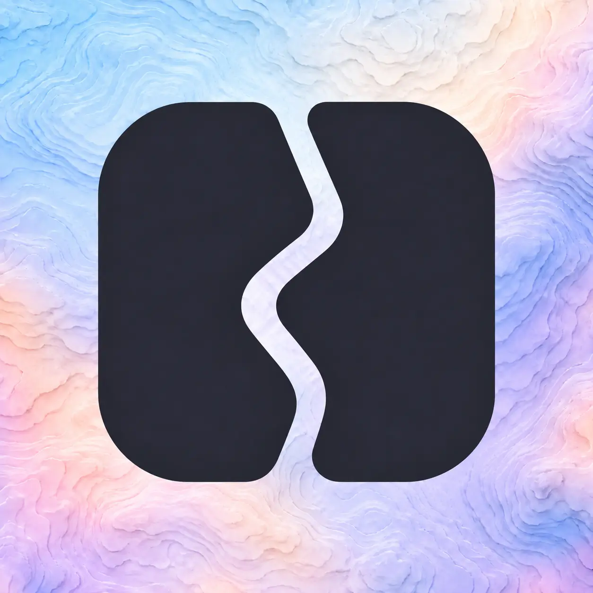
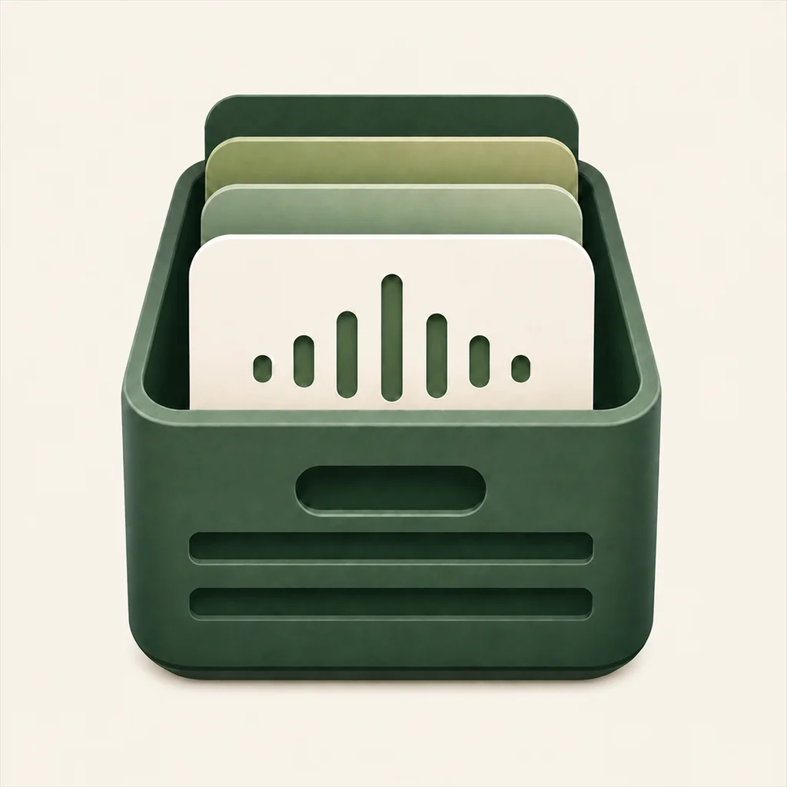

&nbsp;

# Hey, it's Álex 👋

<b>Software Developer</b> · Asturias, Spain

Building apps & websites obsessed with UI/UX, motion and the small details that make a product feel alive.

 

&nbsp;

&nbsp;

&nbsp;

&nbsp;

&nbsp;

---

## 🧱 &nbsp;Now

Right now, I'm building **[RIQO](https://riqoagency.com)**, my web design & Shopify agency. I'm also exploring **digital privacy** and being more intentional about the tech I use. Away from the screen, you'll find me out in **nature** or working on my **calisthenics**.

 

---

## 📱 &nbsp;My apps

<table width="100%">
  <tr>
    <td align="center" width="25%" valign="top">
      
        
      <strong>GeoDuo</strong>
       
      Web
       
      <code>Released</code>
    </td>
    <td align="center" width="25%" valign="top">
      
        
      <strong>Gresca</strong>
       
      Web
       
      <code>Released</code>
    </td>
    <td align="center" width="25%" valign="top">
      
        
      <strong>Cratune</strong>
       
      iOS
       
      <code>TestFlight</code>
    </td>
    <td align="center" width="25%" valign="top">
      
        
      <strong>pump.</strong>
       
      iOS · Android
       
      <code>On hold</code>
    </td>
  </tr>
  <tr>
    <td align="center" width="25%" valign="top">
      
        
      <strong>BurnClaw</strong>
       
      Windows
       
      <code>v2.0.1</code>
    </td>
    <td align="center" width="25%" valign="top">
      
        
      <strong>Ditto</strong>
       
      Windows
       
      <code>v1.1.0</code>
    </td>
    <td align="center" width="25%" valign="top">
      
        
      <strong>Monked</strong>
       
      iOS
       
      <code>v1.0.0</code>
    </td>
    <td align="center" width="25%" valign="top">
      
        
      <strong>Stride</strong>
       
      iOS
       
      <code>v1.1.0</code>
    </td>
  </tr>
</table>

  <i>Tap any icon to peek inside →</i>

 

---

## 🧰 &nbsp;The stack

What I build with.

### Web

<!-- Quita la tecnología que ya no aparece en tu web (allí hay 9) -->

  
  &nbsp;&nbsp;
  
  &nbsp;&nbsp;
  
  &nbsp;&nbsp;
  
  &nbsp;&nbsp;
  
  &nbsp;&nbsp;
  
  &nbsp;&nbsp;
  
  &nbsp;&nbsp;
  
  &nbsp;&nbsp;
  
  &nbsp;&nbsp;
  

### Mobile

  
  &nbsp;&nbsp;
  
  &nbsp;&nbsp;
  
  &nbsp;&nbsp;
  
  &nbsp;&nbsp;
  
  &nbsp;&nbsp;
  

### Desktop

  
  &nbsp;&nbsp;
  
  &nbsp;&nbsp;
  
  &nbsp;&nbsp;
  

 

---

&nbsp;

Let's build something together → <a href="mailto:hello@asantinos.com"><strong>hello@asantinos.com</strong></a>
 
More at <a href="https://asantinos.com"><strong>asantinos.com</strong></a>

&nbsp;

